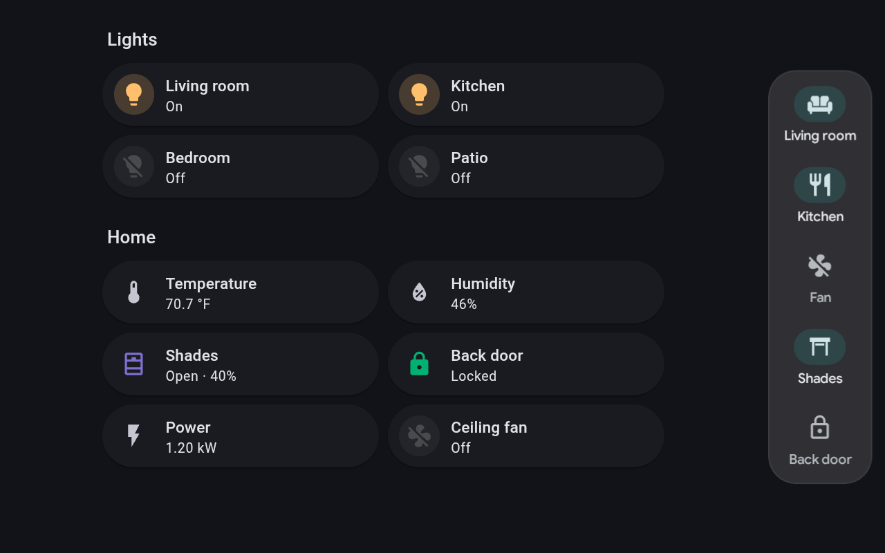
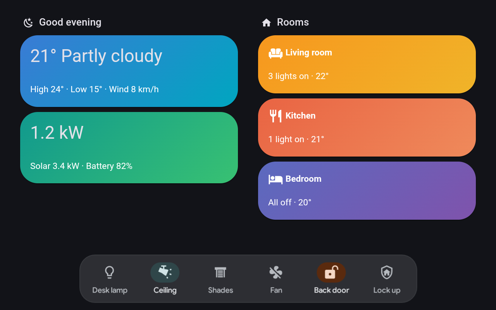
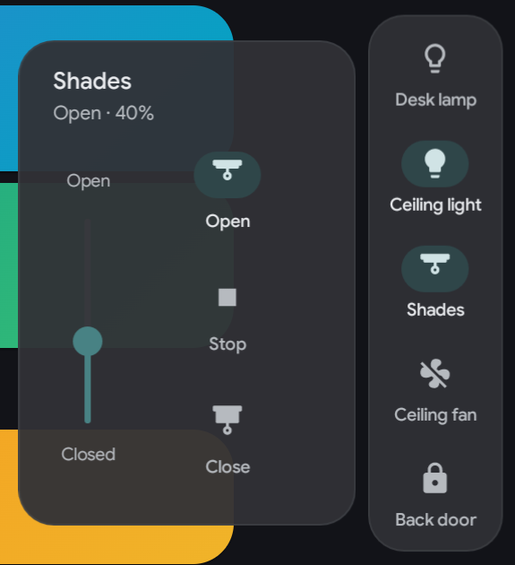
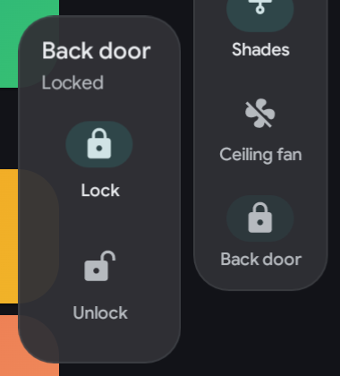
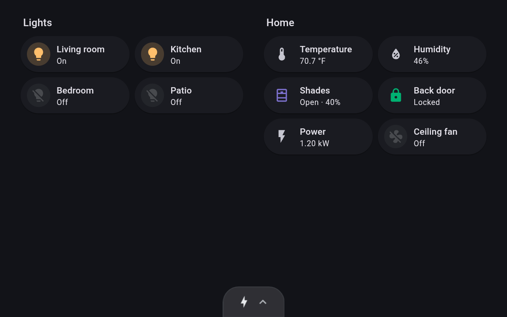
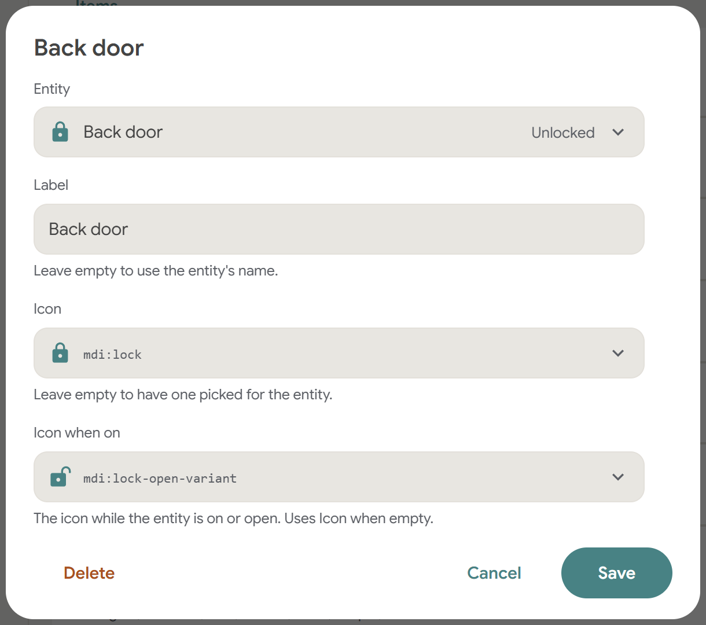
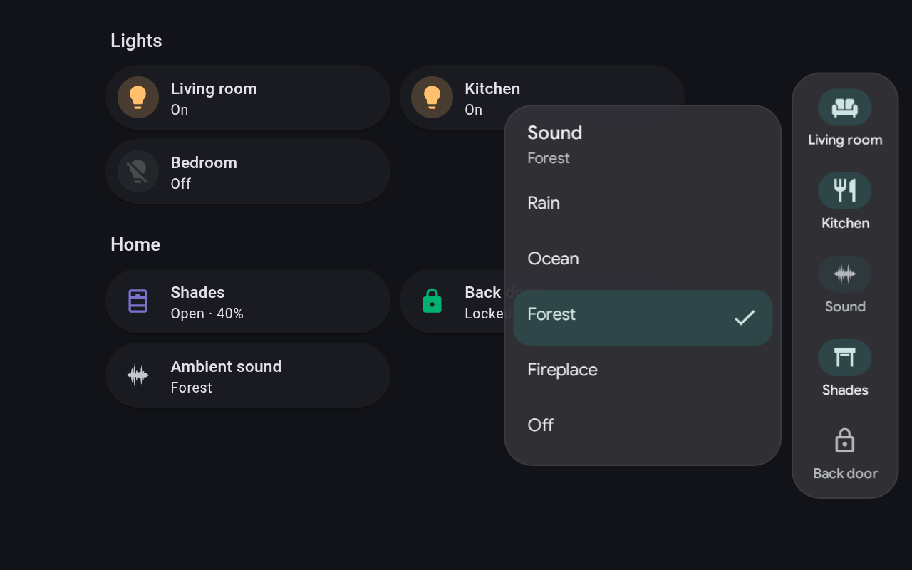
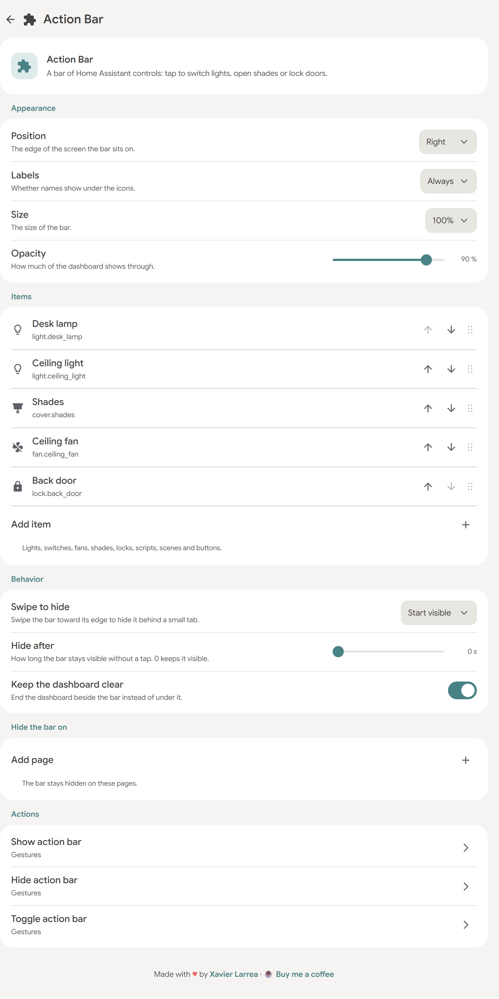

# Action Bar for Kiosk Satellite

**One-tap Home Assistant controls for [Kiosk Satellite](https://github.com/jxlarrea/kiosk-satellite) wall panels.** Switch a light, open the shades or lock up, from any page, without opening a dashboard. Each button shows its entity's live state, and Kiosk Satellite draws the bar with its own colors, type and icons, so it looks like part of the kiosk.

<p align="center"></p>

| Along the bottom | Shades and locks | Hidden |
| :---: | :---: | :---: |
|  |   |  |
| A bar along the top or bottom | A tap opens a menu beside the button | Swipe it away behind a small tab |

A companion to [Navbar for Kiosk Satellite](https://github.com/dimatx/kiosk-satellite-navbar): the navbar moves between pages, the action bar acts in place.

## Why use it

- **One tap, from anywhere.** Lights, switches, fans, shades, scripts, scenes, buttons and media players respond to a single tap, on every page.
- **Live state.** A button lights up while its entity is on or open, dims while it's unavailable, and shows a tap as pending until Home Assistant confirms it.
- **Menus for shades, locks and selects.** A tap on a shade opens Open, Stop and Close with a slider for its position. A tap on a lock opens Lock and Unlock. A tap on an input select or select opens its options. Nothing moves until you choose, and an unlocked lock or open garage stands out in a warning color.
- **No token to manage.** Kiosk Satellite calls Home Assistant through its own connection. The plugin never sees a token.
- **Set up without typing.** Pick each entity from a list, including entities Home Assistant hides, such as a light group hidden from your dashboards. Its name and icon fill themselves in, and you can change them.
- **Fits your layout.** A rail down the right or left, or a bar along the top or bottom. Names wrap to two lines, or hide them for icons only.
- **Light.** Native Android views, no WebView, and only the buttons that change are redrawn.

## Installation

You need Kiosk Satellite **2026.10.25** or newer, connected to Home Assistant. On **2026.10.30** and newer the bar follows each kiosk's **Scale UI**. On **2026.10.41** and newer the entity picker also lists hidden entities, which older versions leave out.

### Community Plugins (Recommended)

Action Bar is listed in [Community Plugins](https://kiosksatellite.com/plugins/). Use the button below to open it in your Kiosk Satellite and install it.

[](https://kiosksatellite.com/redirect/plugin/?repository=dimatx/kiosk-satellite-action-bar)

Or search for `Action Bar` in **Settings > Plugin Manager > Browse plugins** in Kiosk Satellite.

### Manual

1. Open **Settings > Plugin Manager** in Kiosk Satellite and turn on **Enable Plugins**.
2. Choose **Add plugin**, paste `https://github.com/dimatx/kiosk-satellite-action-bar` and choose **Preview**.
3. Review the plugin and choose **Trust and install**.

### First steps

Turn on **Action Bar**, open it and tap **Add item**. Pick an entity and tap **Save**. Its button appears on the right edge of the screen.

Settings are on the plugin's page, on the kiosk or in Remote Admin, and take effect as soon as you save them.

## Adding items

<p align="center"></p>

Each item is one Home Assistant entity, with up to 16 items.

- **Entity.** Pick it from the list.
- **Label.** Leave it empty and the entity's name is filled in for you.
- **Icon** and **Icon when on.** Leave them empty and icons for the entity's kind are filled in, such as a closed and an open lock. Home Assistant's own icon is used when it's a Material Design Icon.

Drag items by their handle, or use the arrows in Remote Admin, to change their order.

## What a tap does

| Entity | A tap |
| --- | --- |
| Light, switch, fan, input boolean, automation, siren, humidifier | Turns it on or off |
| Shade, blind, curtain, garage door, gate or other cover | Opens a menu with Open, Stop and Close, and a slider for its position when the cover reports one |
| Lock | Opens a menu with Lock and Unlock |
| Input select, select | Opens a menu of its options, with the current one marked. Picking one sets it |
| Script | Starts it, without waiting for it to finish |
| Scene | Activates it |
| Button, input button | Presses it |
| Media player | Plays or pauses it |
| Anything else, such as a sensor | Nothing. The button still shows the entity's state |

A menu opens beside its button, with the buttons nearest the bar. A menu longer than the bar, such as a shade's beside a short rail, is centered on the bar instead. Beside a rail it stands upright, with the slider open at the top. Above or below a bar it lies flat. The current state is highlighted and stays live while the menu is open. A choice acts and closes the menu, letting go of the slider moves the cover and keeps the menu open, and a tap anywhere else closes it. A menu also closes after 30 seconds without a touch.

A select's menu is a list. It shows the entity's options in Home Assistant's order and scrolls when there are more than six. Picking an option only sets the select. What should happen next, such as playing an audiobook or starting a sound, is for a Home Assistant automation or script that triggers on the select changing, so the bar never needs to know what the options mean.

<p align="center"></p>

A long press acts at once, without a menu: on a cover it opens, closes or stops it, and on a lock it locks or unlocks it. On a select a long press does nothing, since there is no single choice to make. On any other button a long press does the same as a tap.

A call is sent once and never retried, because a call that timed out may still have reached Home Assistant. If a call fails, the plugin's page says why. A button whose entity is unavailable ignores taps.

## Settings

<details>
<summary><b>All settings</b></summary>

<p align="center"></p>

| Setting | What it does |
| --- | --- |
| Position | Right, Left, Top or Bottom. Right and Left make a rail |
| Labels | Always, or Never for icons only |
| Size | 80% to 140%, on top of the kiosk's **Scale UI** |
| Opacity | How much of the dashboard shows through |
| Items | Up to 16 entities |
| Swipe to hide | Start visible, Start hidden or Off |
| Hide after | Seconds without a tap before the bar hides. 0 keeps it visible |
| Keep the dashboard clear | The dashboard ends beside the bar instead of under it. On by default |
| Hide the bar on | Pages where the bar stays hidden, picked from your dashboards and Home Assistant's own pages. A bare page such as `energy` also covers its sub-pages |

</details>

<details>
<summary><b>Hiding the bar</b></summary>

Swipe the bar toward its edge to hide it behind a small tab. Swipe the tab back, or tap it, to show the bar again. While the bar is hidden, the dashboard keeps clear of the tab only.

**Show action bar**, **Hide action bar** and **Toggle action bar** can be mapped to a gesture or added to the kiosk drawer, under the plugin's **Actions**.

</details>

<details>
<summary><b>Questions</b></summary>

**A button shows a generic icon instead of the one in Home Assistant.** Icons from community icon packs, such as `phu:`, aren't available to Kiosk Satellite plugins, so the bar uses an icon for the entity's kind. Pick another icon for the item to change it.

**An entity is missing from the list.** The list leaves out entities hidden in Home Assistant. Unhide it under **Settings > Entities** to pick it.

**Does it work with Fleet Management?** Yes, but a profile syncs all of a plugin's settings, so every kiosk on it gets the same items. To give each room its own buttons, leave Action Bar out of the profile's **Plugins** row and install it on each kiosk.

**The plugin's page says an entity was not found.** Kiosk Satellite's Home Assistant user can't see it, or it was renamed. Pick the entity again.

**Does it work with the navbar?** Yes. Put the navbar along the bottom and the action bar on the right, and the dashboard keeps clear of both.

</details>

<details>
<summary><b>Build from source</b></summary>

Needs a JDK, Python 3 and the Android SDK with `ANDROID_HOME` set.

```sh
python3 tools/test.py
python3 tools/build.py
```

`tools/test.py` runs the logic tests and drives the plugin with a virtual clock and a fake host that records every Home Assistant call. `python3 tools/test_views.py --serial <adb-device-serial>` measures the native views on an adb-connected development device without installing an app.

The ZIP lands in `dist/`. Install it with **Plugin Manager > Developer Tools > Install from ZIP**. To release, publish a GitHub release tagged `vX.Y.Z`. CI tests, builds and attaches the files Kiosk Satellite verifies. See [CHANGELOG.md](CHANGELOG.md) for what changed in each version. [docs/releasing.md](docs/releasing.md) covers versions, releases and keeping settings across updates.

</details>

## Privacy

Action Bar talks only to your own Home Assistant, and only through Kiosk Satellite's connection. It reads the state of the entities you add and, when you tap, calls the matching service on that entity, such as `homeassistant.toggle` or `lock.unlock`. It never sees a Home Assistant token and sends nothing anywhere else.

## Credits

Built for [Kiosk Satellite](https://github.com/jxlarrea/kiosk-satellite) by [@jxlarrea](https://github.com/jxlarrea), whose plugin SDK, overlays, pickers, icons and Home Assistant access make a bar like this possible. Started from the [Kiosk Satellite plugin template](https://github.com/jxlarrea/kiosk-satellite-plugins), and shares its overlay work with [Navbar for Kiosk Satellite](https://github.com/dimatx/kiosk-satellite-navbar). Plugin SDK limits found along the way are tracked in [docs/sdk-gaps.md](docs/sdk-gaps.md).

## License

[Apache-2.0](LICENSE). See [NOTICE](NOTICE) for what comes from the Kiosk Satellite plugin template.
